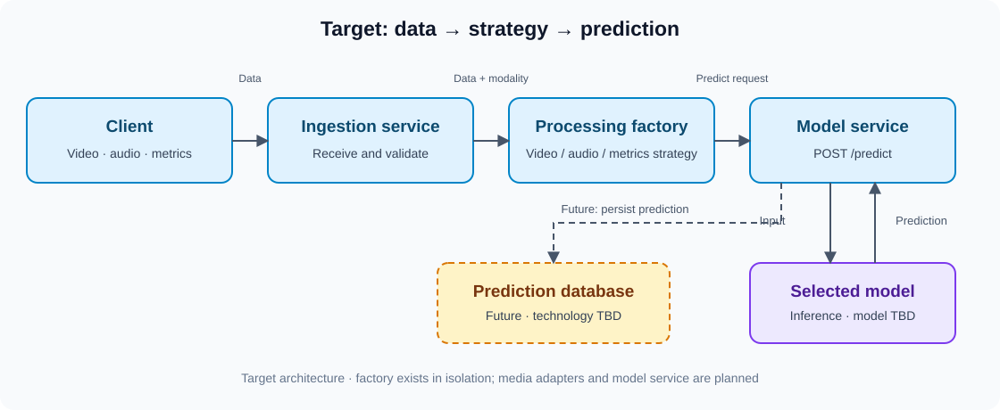

# astro-health-monitor

Astronaut health monitoring and early risk detection platform for NASA Space Apps Challenge 2026.

## System design

### Dashboard


The browser polls `GET /api/dashboard` every 15 seconds. The API reads crew data through `CrewRepository`, evaluates metric/prediction rules and freshness, and returns crew status and alerts. Today the repository joins JSON demo files by astronaut ID. Itamar will replace it with a database adapter for users, metrics, and predictions; the handoff is marked `TODO(@itamar)` in `repository.py`.

### Video / data upload



This is the target upload architecture. Currently `/upload` calls the existing `POST /api/video`: check filename extension → save video → select video processor → call `run_model()` → return cardioresp estimates for heart rate (HR), respiratory rate (RR), and pulse-respiration quotient (PRQ). All processing strategies currently pass input through unchanged; video is connected, while audio/metrics endpoints and a separate `/predict` service remain planned. The model returns latest HR/RR/PRQ, timestamped measurements, and recording-level median summaries. Invalid recordings return HTTP 422. Recordings need a visible frontal face, stable lighting, minimal movement, and at least 30 seconds of usable video (60+ recommended). This experimental model is not validated for medical decisions, astronauts, or microgravity; `ok` means computation succeeded. Database writes are not connected, so uploaded results do not update the dashboard yet. Both flows run in one FastAPI app, with sidebar links between dashboard and upload.

## Run with Docker

From the repository root with Docker running:

```bash
# Development: Python reload, mounted frontend and demo data
docker compose -f compose.yaml -f compose.dev.yaml up --build

# Production: source and demo files baked into the image, no reload
docker compose up --build -d
```

Open http://localhost:8000/ for the dashboard, `/upload` for video upload, or `/docs` for the API. No separate frontend server or build is needed. In development, Python changes reload automatically; refresh the browser after HTML/CSS/JS edits. Demo JSON changes appear on the next dashboard fetch (every 15 seconds). Rebuild after dependency changes; production requires rebuilding for all source/data changes.

Use one mode at a time. Stop development with Ctrl+C; run `docker compose down` to remove containers. Uploads persist in a named volume; `down -v` deletes them. View logs with `docker compose logs -f app`. The image runs as a non-root user with a `/api/health` health check.

If port 8000 is occupied, prefix the command with `APP_PORT=8001` and open http://localhost:8001/. PowerShell: set `$env:APP_PORT = "8001"` first. Inspect configuration with `docker compose config` (include both `-f` flags for development).

## Run without Docker

Python 3.11+ is required. From the repository root:

```bash
cd backend
python -m venv .venv
# Linux/macOS: source .venv/bin/activate
# Windows: .venv\Scripts\activate
pip install -r requirements.txt
uvicorn app.main:app --reload
```

Open http://127.0.0.1:8000/. This starts both the API and UI. From `backend/`, install pytest with `python -m pip install pytest`, then run `python -m pytest -v` for all tests.

## Demo data and status rules

`data/astronauts.json` contains profiles, `metrics.json` contains timestamped readings/history, and `predictions.json` contains synthetic model scores. Records join by astronaut ID. Files reload on each API request; `rules.json` configures inclusive metric ranges, prediction thresholds, and freshness duration.

- **Needs attention:** a metric is outside its range or a prediction meets/exceeds its threshold.
- **Unknown:** no alert, but required metrics are missing or observations are stale.
- **Healthy:** required metrics are fresh/present and no rule triggers. These are illustrative demo rules, not a clinical assessment.

The demo clock is the latest fixture timestamp. Member details show trends, predictions, and alert reasons. Alerts are calculated on request; saved alert history and external notifications remain future work. Astronaut IDs are provided by demo records or entered manually on upload; automatic identity recognition is not implemented.

## Dashboard class relationships


## Repository structure

```text
astro-health-monitor/
├── README.md                       # Setup, architecture, and demo behavior
├── Dockerfile                      # Production image, including cardioresp package
├── .dockerignore                   # Exclude local/private files from builds
├── compose.yaml                    # Production configuration and uploads volume
├── compose.dev.yaml                # Development source mounts and reload
├── backend/
│   ├── requirements.txt
│   ├── vendor/                     # Vendored cardioresp wheel
│   ├── app/
│   │   ├── main.py                 # FastAPI setup, pages, and static assets
│   │   ├── dashboard/
│   │   │   └── repository.py       # Demo data models/reader; database handoff
│   │   ├── routers/
│   │   │   ├── dashboard.py        # Snapshot API and status/alert functions
│   │   │   └── video.py            # Video upload and analysis endpoint
│   │   ├── models/
│   │   │   └── video_model.py      # HR/RR/PRQ model adapter
│   │   └── processing/
│   │       ├── factory.py          # Select video/audio/metrics strategy
│   │       └── strategies.py       # Current pass-through processors
│   ├── tests/
│   │   ├── test_dashboard.py
│   │   ├── test_processing.py
│   │   └── test_video_model.py
│   └── uploads/                    # Runtime videos, ignored by Git
├── frontend/
│   ├── index.html                  # Crew dashboard and detail dialog
│   ├── dashboard.css               # Shared theme, sidebar, responsive layouts
│   ├── dashboard.js                # Polling, rendering, filters, member details
│   └── upload.html                 # Video form and analysis results
├── data/
│   ├── astronauts.json
│   ├── metrics.json
│   ├── predictions.json
│   └── rules.json
└── docs/diagrams/
    ├── dashboard-classes.svg       # Repository and data-model relationships
    ├── dashboard-design.svg        # Dashboard read flow
    └── system-design.svg           # Target upload/prediction flow
```

Python package markers and empty-directory placeholders are omitted from the tree. Next decisions: model/preprocessing contracts, ingestion limits and retention, synchronous versus asynchronous prediction, and database persistence/retry behavior.
