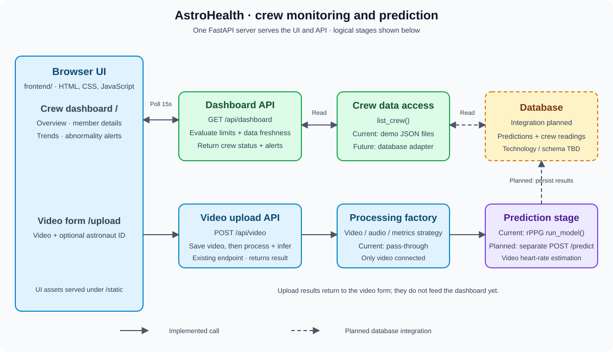
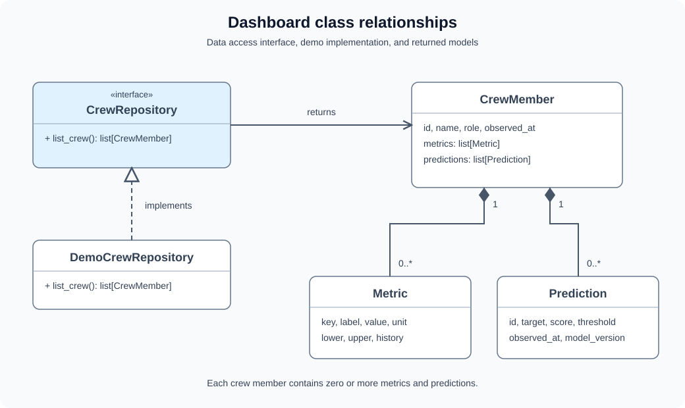

# astro-health-monitor

Astronaut health monitoring and early risk detection platform for NASA Space Apps Challenge 2026.

## System design

### Dashboard



The browser polls `GET /api/dashboard` every 15 seconds. The API reads crew data through `CrewRepository`, evaluates metric/prediction rules and freshness, and returns crew status and alerts. By default the repository reads the SQLite database (`DatabaseCrewRepository`): the `astronauts` roster (filled from `data/astronauts.json` on first run) and the readings saved from uploaded videos. Set `ASTROHEALTH_DASHBOARD=demo` to show the JSON demo files instead (`DemoCrewRepository`).

### Video / data upload


This is the target upload architecture. Currently `/upload` calls the existing `POST /api/video`: check filename extension → save video → select video processor → call `run_model()` → return cardioresp estimates for heart rate (HR), respiratory rate (RR), and pulse-respiration quotient (PRQ). All processing strategies currently pass input through unchanged; video is connected, while audio/metrics endpoints and a separate `/predict` service remain planned. The model returns latest HR/RR/PRQ, timestamped measurements, and recording-level median summaries. Invalid recordings return HTTP 422. Recordings need a visible frontal face, stable lighting, minimal movement, and at least 30 seconds of usable video (60+ recommended). This experimental model is not validated for medical decisions, astronauts, or microgravity; `ok` means computation succeeded. Uploaded results are saved to the database and appear on the dashboard on its next refresh. Both flows run in one FastAPI app, with sidebar links between dashboard and upload.

## Run with Docker

From the repository root with Docker running:

```bash
# Development: Python reload, mounted frontend and demo data
docker compose -f compose.yaml -f compose.dev.yaml up --build

# Production: source and demo files baked into the image, no reload
docker compose up --build -d
```

Open http://localhost:8000/ for the dashboard, `/upload` for video upload, or `/docs` for the API. No separate frontend server or build is needed. In development, Python changes reload automatically; refresh the browser after HTML/CSS/JS edits. Demo JSON changes appear on the next dashboard fetch (every 15 seconds). Rebuild after dependency changes; production requires rebuilding for all source/data changes.

Use one mode at a time. Stop development with Ctrl+C; run `docker compose down` to remove containers. Uploads and SQLite persist in separate named volumes; `down -v` deletes both. View logs with `docker compose logs -f app`. The image runs as a non-root user with a `/api/health` health check.

If port 8000 is occupied, prefix the command with `APP_PORT=8001` and open http://localhost:8001/. PowerShell: set `$env:APP_PORT = "8001"` first. Inspect configuration with `docker compose config` (include both `-f` flags for development).

## Run without Docker

Python 3.11+ is required. From the repository root:

```bash
cd backend
python -m venv .venv
# Linux/macOS: source .venv/bin/activate
# Windows: .venv\Scripts\activate
pip install -r requirements.txt
uvicorn app.main:app --reload
```

Open http://127.0.0.1:8000/. This starts both the API and UI. From `backend/`, install pytest with `python -m pip install pytest`, then run `python -m pytest -v` for all tests.

## Demo data and status rules

`data/astronauts.json` contains profiles, `metrics.json` contains timestamped readings/history, and `predictions.json` contains synthetic model scores. Records join by astronaut ID. Files reload on each API request; `rules.json` configures inclusive metric ranges, prediction thresholds, and freshness duration.

- **Needs attention:** a metric is outside its range or a prediction meets/exceeds its threshold.
- **Unknown:** no alert, but required metrics are missing or observations are stale.
- **Healthy:** required metrics are fresh/present and no rule triggers. These are illustrative demo rules, not a clinical assessment.

The demo clock is the latest fixture timestamp. Member details show trends, predictions, and alert reasons. Alerts are calculated on request; saved alert history and external notifications remain future work. Astronaut IDs are provided by demo records or entered manually on upload; automatic identity recognition is not implemented.

## Dashboard class relationships



## Database in Docker, venv, and the team

Both runtimes use the same SQLite code and schema, with different storage locations:

| Runtime | Database location | Persistence |
| --- | --- | --- |
| Local venv | `backend/astrohealth.db` | Local file, ignored by Git |
| Docker (dev and production) | `/app/storage/astrohealth.db` | Named `database` volume, writable by the app user |

`ASTROHEALTH_DB` overrides the file path for either runtime; missing parent directories are created automatically. For example, from `backend/`: `ASTROHEALTH_DB=/absolute/path/astrohealth.db uvicorn app.main:app --reload`. PowerShell: set `$env:ASTROHEALTH_DB` before starting. Recreate existing containers with `docker compose -f compose.yaml -f compose.dev.yaml up -d --build` to pick up the storage configuration. Existing local databases are not automatically copied into Docker.

These local files/volumes are independent; they do not synchronize across teammates. To share live data, run one central API/dashboard with persistent storage and have the team use its URL. If each teammate's local backend must access a shared database, migrate the storage adapter to a network database such as PostgreSQL. The current `ASTROHEALTH_DB` setting accepts a SQLite file path, not a PostgreSQL URL. Do not synchronize a running SQLite file through Git or a shared drive.

## Prediction storage (SQLite)

Everything is stored in one SQLite file, `backend/astrohealth.db` (created on
first use, not committed to git; set `ASTROHEALTH_DB` to use another path).
All database code is in `backend/app/db.py`. There are two tables:

- **predictions**: one row per model run (e.g. one uploaded video). It keeps
  the model's full output as JSON, its `model`, `status`, and whether it is an
  alert. This is what the UI shows as status and alerts.
- **measurements**: every reading, for charts and trend analysis. Each row is
  one value: astronaut, `source`, `metric`, value, unit, time. Each model has
  its own metrics, so `source` is the model name (e.g. `cardioresp`) and
  `metric` is its field (e.g. `hr_bpm`). Values entered by hand, e.g. a lab
  result, have `source = "manual"` and no `prediction_id`.

After each model run, `backend/app/extractors.py` picks the readings out of the
model output. For `cardioresp` it saves every reading with status `ok` or
`partial`: `hr_bpm`, `respi_rate` and `prq` (a 60 s video gives about 30
readings x 3 metrics). `warming_up` and `no_face` readings have no values and
are skipped. A reading's time is the upload time plus its `timestamp_s`
(stored as `offset_s`); approximate, since we don't know when the video was
recorded. A new model needs one small function in that file.

A prediction is an alert if the model returns `"alert": true`, or if the
**median** of a metric's readings in that video is outside its range in
`ALERT_RANGES` (`backend/app/db.py`). The median, so one noisy reading doesn't
raise an alert. Today the only range is cardioresp heart rate 40-120 bpm, a
placeholder until someone sets real limits. Respiratory rate has no range
because cardioresp's RR is not validated. The model `status` describes video
quality, not health, so it never triggers an alert; it is still saved so the
UI can say "retake the video".

| Endpoint | What it returns |
| --- | --- |
| `GET /api/predictions?astronaut_id=A-07&limit=50` | Model runs, newest first (omit `astronaut_id` for everyone) |
| `GET /api/predictions/{id}` | One model run, with its full output |
| `GET /api/alerts` | Alerts nobody has handled, newest first (`?astronaut_id=`, `?include_acknowledged=true`) |
| `POST /api/alerts/{id}/ack` | Marks an alert as handled |
| `GET /api/measurements?astronaut_id=A-07&source=cardioresp&metric=hr_bpm&since=2026-11-01` | Readings oldest first, ready for a chart (all filters optional, plus `prediction_id` for one video, `until`, `limit`) |
| `POST /api/measurements` | Add one value by hand (JSON: `astronaut_id`, `metric`, `value`, optional `unit`, `measured_at`, `source` (default `manual`)) |

A measurement looks like:

```json
{"id": 1, "astronaut_id": "A-07", "source": "cardioresp", "metric": "hr_bpm",
 "value": 71.8, "unit": "bpm", "measured_at": "2026-11-14T12:20:01.000+00:00",
 "offset_s": 30.0, "prediction_id": 1}
```

`POST /api/video` now also returns `prediction_id`, `created_at`, `is_alert`
and the `measurements` it saved.

Tests: from `backend/`, run `python -m pytest -q`.

If you ran an earlier version of this branch, delete `backend/astrohealth.db`
once; it will be recreated with the current tables.

The dashboard (`GET /api/dashboard`) reads this database through
`DatabaseCrewRepository` in `backend/app/dashboard/repository.py`. `DB_METRICS`
there maps each dashboard metric in `data/rules.json` to a stored
`(source, metric)`; today only `heart_rate` -> `("cardioresp", "hr_bpm")`.
Rule metrics with no mapping (e.g. `oxygen`) are not shown, and risk-score
predictions stay empty until a model produces scores. Note the dashboard's
alerts use the ranges in `data/rules.json`, separate from `ALERT_RANGES` above.

## Input pages and SQLite simulation

The left sidebar links to **Dashboard** (`/`), **Manual measurements** (`/measurements`), **Video** (`/upload`), and **Audio** (`/audio`). Audio accepts an uploaded file or microphone recording (browser permission required on localhost/HTTPS), previews it, and stores it through `POST /api/audio` in the persistent uploads volume. Audio size is limited to 20 MiB; validation currently checks the extension and size, not media content. No audio health model or prediction persistence is connected yet.

To populate the database with the original synthetic JSON readings, explicitly run:

```bash
# Docker (running container)
docker compose exec app python -m app.seed_demo
# Venv, from backend/
python -m app.seed_demo
```

Seeding is repeatable and adds only missing simulation observations; it preserves existing profiles/readings. Simulation readings use `source=simulation`, not `manual` or `cardioresp`. When simulation readings exist and no cardioresp measurements exist, the dashboard uses a clearly labeled SQLite simulation replay with freshness evaluated at the latest simulated observation. As soon as real model readings exist, the dashboard returns to live mode and normal freshness rules. Manual observations remain separate and viewable in member details. The biologist's CSV is not imported or interpreted by this seed command.

## Manual measurements and biomarker intake

Use **Manual measurements** in the sidebar, select an astronaut and collection time, then enter values in the displayed units. Systolic and diastolic pressures are saved together in one transaction. Results are saved as `source=manual` in SQLite and appear in member details after refresh. Manual measurements do not yet affect status/alerts; approved analyte-specific rules and freshness windows are needed first.

- `GET /api/measurement-catalog`: provisional group/analyte keys and fixed units.
- `POST /api/manual-measurements`: `{astronaut_id, group_id, measured_at, values: {analyte_key: number}}`. Requires a registered astronaut, timezone-aware time and finite numeric values. Units come from the catalogue, not client input. It does not convert units.
- Existing `POST /api/measurements` remains for generic numeric integrations. Use the validated panel endpoint for the new UI. Member details show the latest manual value per metric from up to 10,000 recent manual rows; full history is available through `GET /api/measurements`.

The BM identifiers are team-provided labels, not a confirmed published standard. The following is a researched interpretation and a provisional catalogue, not a final vendor/lab contract. Only the listed numeric summaries are accepted now; reports, images, categorical findings and raw signals still need defined formats.

| Group | Likely result structure / current preparation |
| --- | --- |
| BM01 CBC/WBC/Lymph/Hgb | Panel of named blood counts: WBC and absolute lymphocytes (`10^9/L`), lymphocyte percentage, hemoglobin (`g/dL`). [CBC reference](https://medlineplus.gov/lab-tests/complete-blood-count-cbc/) |
| BM02 CMP/Glucose/Ca/Renal | Multiple analytes; selected fields are glucose, calcium, creatinine and BUN (`mg/dL`). This is not the full 14-analyte CMP. [CMP reference](https://medlineplus.gov/lab-tests/comprehensive-metabolic-panel-cmp/) |
| BM03 CRP/Cytokines | CRP (`mg/L`) plus an assay-dependent cytokine panel. CRP is supported; cytokine identifiers/units remain pending. [CRP reference](https://medlineplus.gov/lab-tests/c-reactive-protein-crp-test/) |
| BM04 Urine chemistry | Separate calcium concentration, specific gravity, pH, and citrate result. Intake distinguishes spot calcium (`mg/dL`) from 24-hour citrate (`mg/24h`); confirm collection protocol. [Urinalysis reference](https://medlineplus.gov/urinalysis.html) |
| BM05 Urine proteomics/UTI | Protein-by-sample matrix/assay output and urine culture/organism findings, not one scalar. Registered but no numeric form yet. [NASA urine protein dataset](https://osdr.nasa.gov/bio/repo/data/studies/OSD-656), [UTI testing](https://www.niddk.nih.gov/health-information/urologic-diseases/bladder-infection-uti-in-adults/diagnosis) |
| BM06 HR/HRV/RMSSD | HR (`bpm`), RMSSD (`ms`); raw beat intervals and analysis window are separate future inputs. [PhysioNet HRV definitions](https://archive.physionet.org/tutorials/hrv/) |
| BM07 Respiratory rate/CO₂ | Respiratory rate (`breaths/min`); proposed end-tidal CO₂ (`mmHg`). Blood total CO₂ and cabin CO₂ are different quantities and need separate identifiers; provider specification pending. |
| BM08 PTT/Blood pressure | Paired systolic/diastolic BP (`mmHg`), separate PTT (`ms`). Do not infer BP directly from PTT without a validated device/calibration. [AHA cuffless measurement statement](https://professional.heart.org/en/science-news/cuffless-devices-for-the-measurement-of-blood-pressure/top-things-to-know) |
| BM09 Sleep/WASO/Efficiency | Per-night summary: wake after sleep onset (`min`), sleep efficiency (`%`). Sleep-session boundaries/device definitions remain pending. [Sleep efficiency research](https://pmc.ncbi.nlm.nih.gov/articles/PMC4751425/) |
| BM10 ONSD/IJV ultrasound | Left/right ONSD (`mm`) summaries are supported. IJV flow/area, laterality, posture, acquisition protocol and image/cine references need a separate contract. [NASA ONSD](https://ntrs.nasa.gov/citations/20140013312), [NASA venous flow context](https://www.nasa.gov/wp-content/uploads/2026/01/ochmo-mtb-007-venous-thrombosis-in-spaceflight.pdf) |
| BM11 Cognitive/PERCLOS/CTB | PERCLOS (`%`) over a defined window; closure definition matters. CTB abbreviation, task IDs, response times and score scales need confirmation. [Original PERCLOS research](https://www.govinfo.gov/content/pkg/GOVPUB-TD2-PURL-gpo6571/pdf/GOVPUB-TD2-PURL-gpo6571.pdf) |
| BM12 Skin/Rash/Microbiome | Rash observations/photos and taxon-by-sample counts/abundances, with specimen/site metadata. Registered, with no invented numeric rash scale. [Spaceflight skin study](https://www.nature.com/articles/s41467-024-48625-2) |

Body temperature is also supported in Celsius under `VITALS`. Before automated integration, agree on specimen/site, assay/device, collection/session ID, units, quality flags, reference intervals, and image/report attachments. The current numeric storage is a first step, not support for raw omics or ultrasound files.

## Repository structure

```text
astro-health-monitor/
├── README.md                       # Setup, architecture, and demo behavior
├── Dockerfile                      # Production image, including cardioresp package
├── .dockerignore                   # Exclude local/private files from builds
├── compose.yaml                    # Production configuration and uploads volume
├── compose.dev.yaml                # Development source mounts and reload
├── backend/
│   ├── requirements.txt
│   ├── vendor/                     # Vendored cardioresp wheel
│   ├── app/
│   │   ├── seed_demo.py             # Explicit, repeatable SQLite simulation seed
│   │   ├── measurement_catalog.py  # Provisional biomarker groups and analyte units
│   │   ├── main.py                 # FastAPI setup, pages, and static assets
│   │   ├── db.py                   # SQLite storage: predictions, measurements, alert rule
│   │   ├── extractors.py           # Model output -> measurement rows, per model
│   │   ├── dashboard/
│   │   │   └── repository.py       # Demo data models/reader; database handoff
│   │   ├── routers/
│   │   │   ├── dashboard.py        # Snapshot API and status/alert functions
│   │   │   ├── predictions.py      # Prediction history and alerts API
│   │   │   ├── audio.py            # Audio storage endpoint (no model yet)
│   │   │   ├── measurements.py     # Trends, generic readings, validated manual panels
│   │   │   └── video.py            # Video upload and analysis endpoint
│   │   ├── models/
│   │   │   └── video_model.py      # HR/RR/PRQ model adapter
│   │   └── processing/
│   │       ├── factory.py          # Select video/audio/metrics strategy
│   │       └── strategies.py       # Current pass-through processors
│   ├── tests/
│   │   ├── test_manual_measurements.py
│   │   ├── test_dashboard.py
│   │   ├── test_processing.py
│   │   └── test_video_model.py
│   └── uploads/                    # Runtime videos, ignored by Git
├── frontend/
│   ├── index.html                  # Crew dashboard and detail dialog
│   ├── dashboard.css               # Shared theme, sidebar, responsive layouts
│   ├── measurements.html           # Manual measurement page
│   ├── audio.html                  # Audio upload / recording page
│   ├── audio.js                    # Microphone, preview, audio submission
│   ├── manual.js                   # Manual measurement form and saving
│   ├── dashboard.js                # Polling, rendering, filters, member details
│   └── upload.html                 # Video form and analysis results
├── data/
│   ├── astronauts.json
│   ├── metrics.json
│   ├── predictions.json
│   └── rules.json
└── docs/diagrams/
    ├── dashboard-classes.svg       # Repository and data-model relationships
    ├── dashboard-design.svg        # Dashboard read flow
    └── system-design.svg           # Target upload/prediction flow
```

Python package markers and empty-directory placeholders are omitted from the tree. Next decisions: model/preprocessing contracts, ingestion limits and retention, synchronous versus asynchronous prediction, and database persistence/retry behavior.
