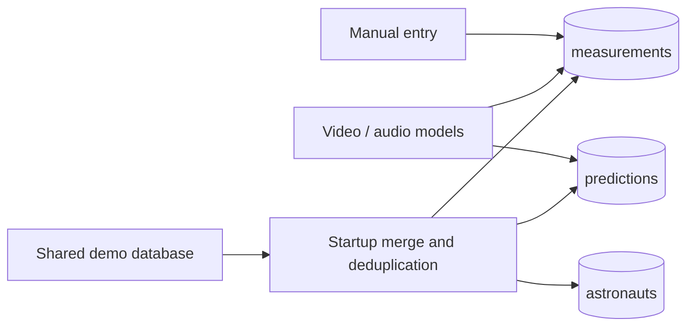
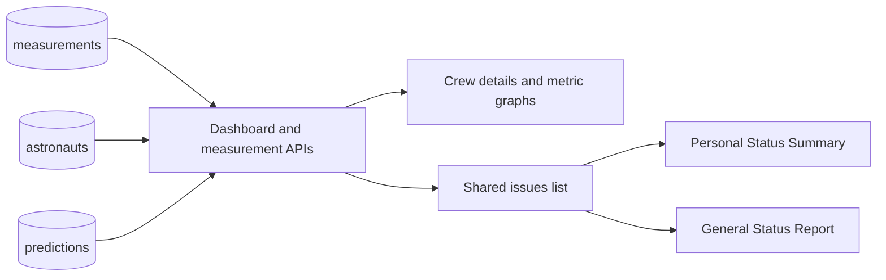
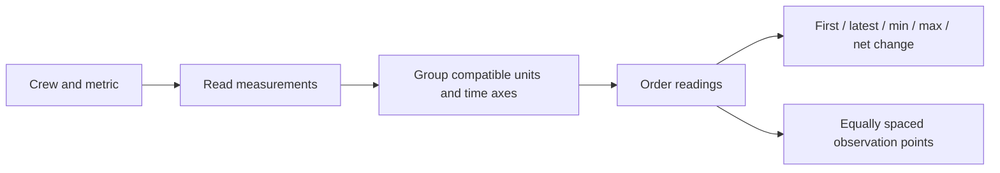
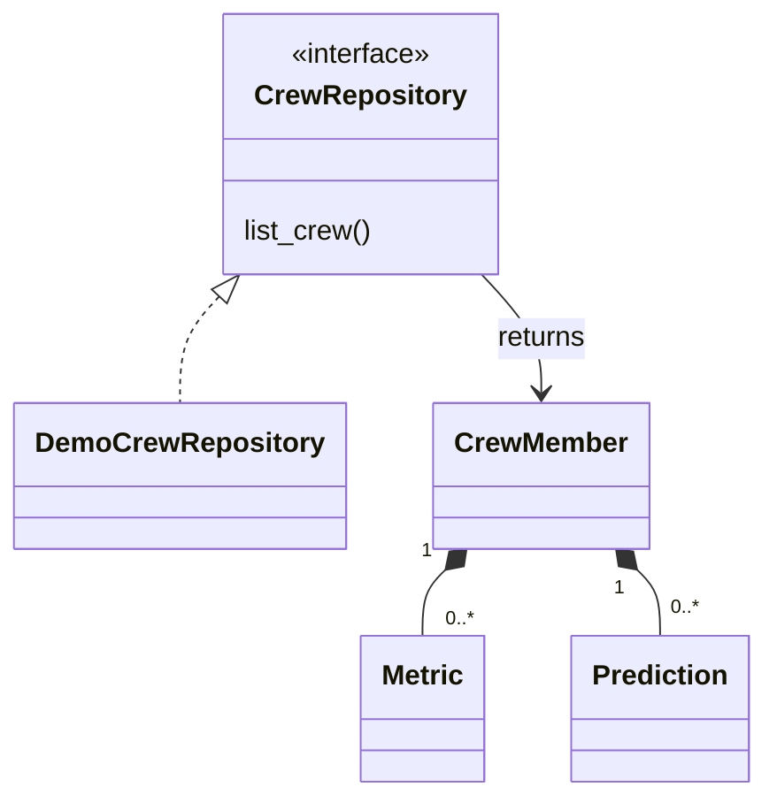

# astro-health-monitor

Astronaut health monitoring and early risk detection platform for NASA Space Apps Challenge 2026.

## System design

Production has three tables: `astronauts` (crew), `predictions` (full model outputs),
and `measurements` (all numeric readings, including the biology CSV). Definitions
are in `data/schema/production.sql`; there are no separate biology graph tables.

### Data insertion



The reviewed `data/seed/shared_demo.db` contains 4 crew, 10 predictions and 616
measurements: 387 seed readings, 220 imported biology values and 9 labeled demo
vitals. Startup remaps conflicting prediction IDs and adds missing measurements;
it does not overwrite local records. The canonical CSV and demo input are kept
under `data/research/` and `data/demo_vitals.json`. A-02 has an intentional synthetic
HR reading of 105 bpm to demonstrate yellow “Check required.”

### Data visualization



Every metric is plotted once across its sources. Aliases such as `heart_rate` and
`hr_bpm` are normalized using `data/biomarkers.json`. Missing/stale readings and
configured threshold/trend alerts appear in both status reports.

### Trend calculation



`GET /api/measurements/trends?astronaut_id=A-01` uses `app/data/trends.py`.
Graphs use equal observation spacing and UTC `YYYYMMDD HH:mm:ss` labels/tooltips.
Mission-phase readings keep their phase labels instead of invented dates; the
same metric panel can switch between recorded time and mission phases.

The SQLite snapshot is tracked in Git and copied into Docker. Pull this branch
and rebuild/restart Docker to load the same baseline. Runtime uploads stay in the
working database volume. The snapshot is reference data, not live synchronization.

## Run with Docker

From the repository root with Docker running:

```bash
# Development: Python reload, mounted frontend and demo data
docker compose -f compose.yaml -f compose.dev.yaml up --build

# Production: source and demo files baked into the image, no reload
docker compose up --build -d
```

Open http://localhost:8000/ for the dashboard, `/upload` for video upload, or `/docs` for the API. No separate frontend server or build is needed. In development, Python changes reload automatically; refresh the browser after HTML/CSS/JS edits. Demo JSON changes appear on the next dashboard fetch (every 15 seconds). Rebuild after dependency changes; production requires rebuilding for all source/data changes.

Use one mode at a time. Stop development with Ctrl+C; run `docker compose down` to remove containers. Uploads and the working database persist in named volumes; `down -v` deletes them. View logs with `docker compose logs -f app`. The image runs as a non-root user with a `/api/health` health check.

If port 8000 is occupied, prefix the command with `APP_PORT=8001` and open http://localhost:8001/. PowerShell: set `$env:APP_PORT = "8001"` first. Inspect configuration with `docker compose config` (include both `-f` flags for development).

## Run without Docker

Python 3.11+ is required. From the repository root:

```bash
cd backend
python -m venv .venv
# Linux/macOS: source .venv/bin/activate
# Windows: .venv\Scripts\activate
pip install -r requirements.txt
uvicorn app.main:app --reload
```

Open http://127.0.0.1:8000/. This starts both the API and UI. From `backend/`, install pytest with `python -m pip install pytest`, then run `python -m pytest -v` for all tests.

## Demo data and status rules

`data/astronauts.json` contains profiles, `metrics.json` contains timestamped readings/history, and `predictions.json` contains synthetic model scores. Records join by astronaut ID. Files reload on each API request; `rules.json` configures inclusive metric ranges, prediction thresholds, and freshness duration.

- **Needs attention:** a metric is outside its range or a prediction meets/exceeds its threshold.
- **Unknown:** no alert, but required metrics are missing or observations are stale.
- **Healthy:** required metrics are fresh/present and no rule triggers. These are illustrative demo rules, not a clinical assessment.

The demo clock is the latest fixture timestamp. Member details show trends, predictions, and alert reasons. Alerts are calculated on request; saved alert history and external notifications remain future work. Astronaut IDs are provided by demo records or entered manually on upload; automatic identity recognition is not implemented.

## Dashboard class relationships



## Prediction storage (SQLite)

Everything is stored in one SQLite file, `backend/astrohealth.db` (created on
first use, not committed to git; set `ASTROHEALTH_DB` to use another path).
Database access is in `backend/app/db.py`; SQL definitions are in `data/schema/production.sql`. There are three tables:

- **astronauts**: crew IDs, names and roles.

- **predictions**: one row per model run (e.g. one uploaded video). It keeps
  the model's full output as JSON, its `model`, `status`, and whether it is an
  alert. This is what the UI shows as status and alerts.
- **measurements**: every reading, for charts and trend analysis. Each row is
  one value: astronaut, `source`, `metric`, value, unit, time. Each model has
  its own metrics, so `source` is the model name (e.g. `cardioresp`) and
  `metric` is its field (e.g. `hr_bpm`). Values entered by hand, e.g. a lab
  result, have `source = "manual"` and no `prediction_id`.

After each model run, `backend/app/extractors.py` picks the readings out of the
model output. For `cardioresp` it saves every reading with status `ok` or
`partial`: `hr_bpm`, `respi_rate` and `prq` (a 60 s video gives about 30
readings x 3 metrics). `warming_up` and `no_face` readings have no values and
are skipped. A reading's time is the upload time plus its `timestamp_s`
(stored as `offset_s`); approximate, since we don't know when the video was
recorded. A new model needs one small function in that file.

A prediction is an alert if the model returns `"alert": true`, or if the
**median** of a metric's readings in that video is outside its range in
`ALERT_RANGES` (`backend/app/db.py`). The median, so one noisy reading doesn't
raise an alert. Today the only range is cardioresp heart rate 40-120 bpm, a
placeholder until someone sets real limits. Respiratory rate has no range
because cardioresp's RR is not validated. The model `status` describes video
quality, not health, so it never triggers an alert; it is still saved so the
UI can say "retake the video".

| Endpoint | What it returns |
| --- | --- |
| `GET /api/predictions?astronaut_id=A-07&limit=50` | Model runs, newest first (omit `astronaut_id` for everyone) |
| `GET /api/predictions/{id}` | One model run, with its full output |
| `GET /api/alerts` | Alerts nobody has handled, newest first (`?astronaut_id=`, `?include_acknowledged=true`) |
| `POST /api/alerts/{id}/ack` | Marks an alert as handled |
| `GET /api/measurements?astronaut_id=A-07&source=cardioresp&metric=hr_bpm&since=2026-11-01` | Readings oldest first, ready for a chart (all filters optional, plus `prediction_id` for one video, `until`, `limit`) |
| `POST /api/measurements` | Add one value by hand (JSON: `astronaut_id`, `metric`, `value`, optional `unit`, `measured_at`, `source` (default `manual`)) |

A measurement looks like:

```json
{"id": 1, "astronaut_id": "A-07", "source": "cardioresp", "metric": "hr_bpm",
 "value": 71.8, "unit": "bpm", "measured_at": "2026-11-14T12:20:01.000+00:00",
 "offset_s": 30.0, "prediction_id": 1}
```

`POST /api/video` now also returns `prediction_id`, `created_at`, `is_alert`
and the `measurements` it saved.

Tests: from `backend/`, run `python -m pytest -q`.

**Shared data.** Startup merges the reviewed `data/seed/shared_demo.db` baseline.
Repeat imports add no duplicates, and existing local records are preserved.
The JSON seed remains a fallback for databases without a packaged snapshot.
Do not delete a working database to apply an updated baseline.

The dashboard (`GET /api/dashboard`) reads this database through
`DatabaseCrewRepository` in `backend/app/dashboard/repository.py`. `DB_METRICS`
there maps each dashboard metric in `data/rules.json` to a stored
`(source, metric)`; heart and respiratory rates use the latest timestamped live reading across sources; research-phase values are excluded.
Rule metrics with no mapping (e.g. `oxygen`) are not shown, and risk-score
predictions stay empty until a model produces scores. Note the dashboard's
alerts use the ranges in `data/rules.json`, separate from `ALERT_RANGES` above.

## Repository structure

```text
astro-health-monitor/
├── README.md                       # Setup, architecture, and demo behavior
├── Dockerfile                      # Production image, including cardioresp package
├── .dockerignore                   # Exclude local/private files from builds
├── compose.yaml                    # Production configuration and uploads volume
├── compose.dev.yaml                # Development source mounts and reload
├── backend/
│   ├── requirements.txt
│   ├── vendor/                     # Vendored cardioresp wheel
│   ├── app/
│   │   ├── main.py                 # FastAPI setup, pages, and static assets
│   │   ├── db.py                   # SQLite storage: predictions, measurements, alert rule
│   │   ├── extractors.py           # Model output -> measurement rows, per model
│   │   ├── dashboard/
│   │   │   └── repository.py       # Demo data models/reader; database handoff
│   │   ├── routers/
│   │   │   ├── dashboard.py        # Snapshot API and status/alert functions
│   │   │   ├── predictions.py      # Prediction history and alerts API
│   │   │   ├── measurements.py     # Measurements API (trends, manual entry)
│   │   │   └── video.py            # Video upload and analysis endpoint
│   │   ├── models/
│   │   │   └── video_model.py      # HR/RR/PRQ model adapter
│   │   └── processing/
│   │       ├── factory.py          # Select video/audio/metrics strategy
│   │       └── strategies.py       # Current pass-through processors
│   ├── tests/
│   │   ├── test_dashboard.py
│   │   ├── test_processing.py
│   │   └── test_video_model.py
│   └── uploads/                    # Runtime videos, ignored by Git
├── frontend/
│   ├── index.html                  # Crew dashboard and detail dialog
│   ├── dashboard.css               # Shared theme, sidebar, responsive layouts
│   ├── dashboard.js                # Polling, rendering, filters, member details
│   └── upload.html                 # Video form and analysis results
├── data/
│   ├── astronauts.json
│   ├── metrics.json
│   ├── predictions.json
│   └── rules.json
└── docs/diagrams/
    ├── dashboard-design.svg        # Dashboard read flow
    └── system-design.svg           # Target upload/prediction flow
```

Python package markers and empty-directory placeholders are omitted from the tree. Next decisions: model/preprocessing contracts, ingestion limits and retention, synchronous versus asynchronous prediction, and database persistence/retry behavior.

## Manual measurements

Use **Manual measurements** in the sidebar to save one systolic/diastolic pressure, glucose, or temperature reading at a time. Saved values appear in member details; no manual alert rules are applied.
