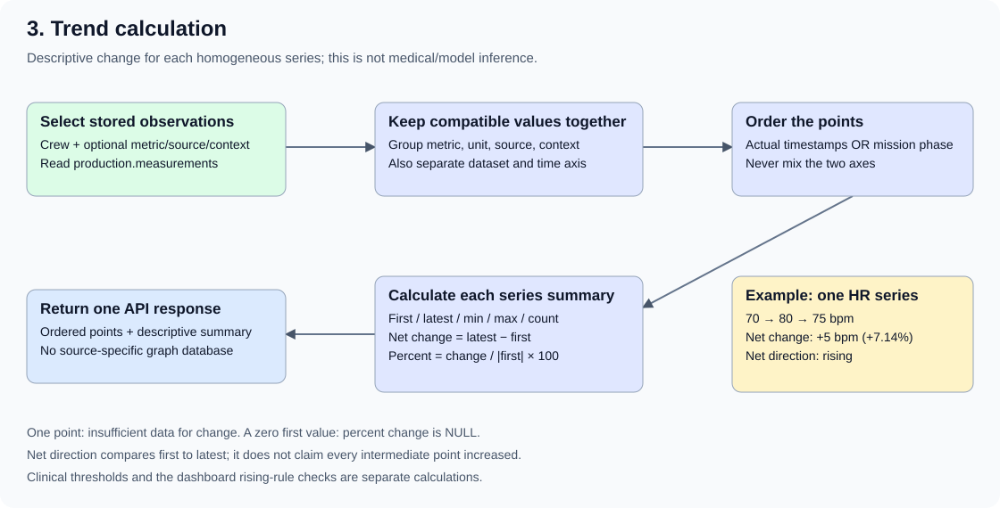
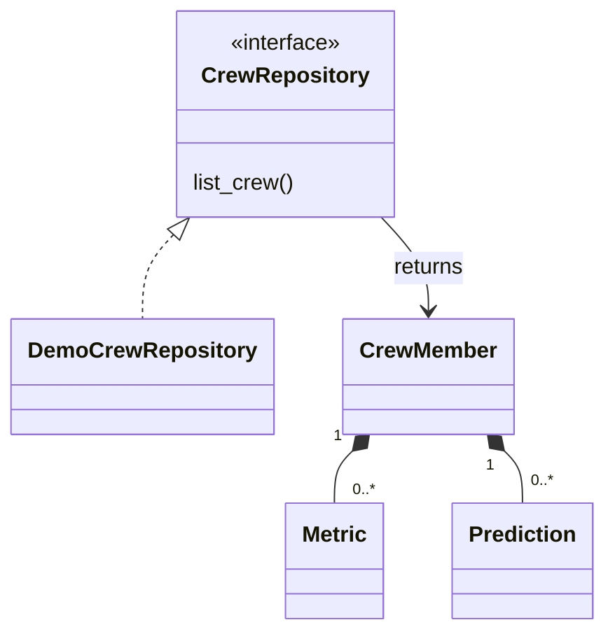

# astro-health-monitor

Astronaut health monitoring and early risk detection platform for NASA Space Apps Challenge 2026.

## System design

Production has exactly three domain tables: **astronauts**, **predictions** and
**measurements**. Every approved manual, model or biology value is stored in
`measurements`. Raw CSV staging and import bookkeeping live in the separate draft
database; graphs do not read values from draft.

| Production table | Stores |
| --- | --- |
| `astronauts` | Crew identities |
| `predictions` | Full model inference results |
| `measurements` | All numeric readings, including the biology CSV |

### Data insertion


Manual entry validates one reading. Video/audio inference saves the full model
result to `predictions` and its extracted numeric readings to `measurements` in one
transaction. The CSV importer validates and stages the file, normalizes biomarker
names/units, maps its four profiles to existing crew IDs, and promotes **220
observations into measurements**. Dataset/row/metric identity prevents duplicates.
Mission phases are stored explicitly; collection timestamps stay NULL when unknown.

### Data visualization


`GET /api/dashboard` reads the roster and configured live readings and evaluates
status/alerts. `GET /api/measurements` reads stored values from any source.
`GET /api/measurements/trends?astronaut_id=A-01&metric=hr_bpm` uses the same table
and returns source-separated model and imported HR series. The older biology graph
endpoint is a compatibility adapter over `measurements`, not another graph store.
Crew detail uses the existing Key Vitals trend layout for every metric, querying the generic API for biology, model and manual readings. Each metric appears once; recorded timestamps and mission phases can be selected within its panel.

### Trend calculation



`app/data/trends.py` groups observations by metric, unit, source, context, dataset
and time axis, then returns ordered points plus count, first/latest, min/max,
net change and percent change. Timestamp and mission-phase series remain separate.
Net direction compares the first and latest value; it is not a claim of monotonic
change. One point has insufficient change data; a zero baseline has no percentage.
These descriptive summaries are separate from model inference and alert rules.

### Code and schema ownership

| Location | Responsibility |
| --- | --- |
| `data/schema/production.sql` | The three production table definitions |
| `data/schema/draft.sql` | Import staging table definitions |
| `data/schema/indexes.sql` | Production query and deduplication indexes |
| `data/biomarkers.json` | Biomarker names, units, aliases, phases and crew mapping |
| `backend/app/db.py` | Production connections, upgrades and row persistence |
| `backend/app/data/imports.py` | CSV validation, staging and promotion |
| `backend/app/data/management.py` | Startup, seed import/export, status and backups; one CLI |
| `backend/app/data/trends.py` | Source-independent trend grouping and calculations |
| `backend/app/routers/` | HTTP request/response handling |

The former root helpers `biologist.py`, `biomarker_catalog.py`,
`data_management.py` and `seed.py` have been consolidated or moved. The earlier shared-API helper was removed from this branch.
There are no duplicate wrapper modules. SQL schema definitions are loaded from
the versioned data files and packaged in the Docker image.

## Data management

Docker keeps the working SQLite database in a persistent volume at
`/app/storage/astrohealth.db`. Startup merges the reviewed `data/seed/shared_demo.db` snapshot and imports the
packaged biology dataset without duplicating or replacing existing readings.
All manual, model and biology readings are stored in `measurements`; trend APIs query that table. Production has only `astronauts`, `predictions` and `measurements`. Raw import staging lives in a separate draft database. The frontend follows the latest `main`, with generic measurement graphs integrated into crew detail.

See [how data is managed](docs/data-management.md) for the file roles, startup,
Docker status/backup commands, deployment behavior and cloud limitations.
Copy `.env.example` to ignored `.env` for supported settings. There is no shared
cloud database today; local and deployed databases are separate by default.
The Docker image includes the CSV, biomarker metadata and SQL definitions. On webapp startup, those files create/load the database automatically; no manual CSV copy or import is needed after deployment.

## Run with Docker

From the repository root with Docker running:

```bash
# Development: Python reload, mounted frontend and demo data
docker compose -f compose.yaml -f compose.dev.yaml up --build

# Production: source and demo files baked into the image, no reload
docker compose up --build -d
```

Open http://localhost:8000/ for the dashboard, `/upload` for video upload, or `/docs` for the API. No separate frontend server or build is needed. In development, Python changes reload automatically; refresh the browser after HTML/CSS/JS edits. Demo JSON changes appear on the next dashboard fetch (every 15 seconds). Rebuild after dependency changes; production requires rebuilding for all source/data changes.

Use one mode at a time. Stop development with Ctrl+C; run `docker compose down` to remove containers. Uploads and SQLite persist in named volumes; `down -v` deletes both. View logs with `docker compose logs -f app`. The image runs as a non-root user with a `/api/health` health check.

If port 8000 is occupied, prefix the command with `APP_PORT=8001` and open http://localhost:8001/. PowerShell: set `$env:APP_PORT = "8001"` first. Inspect configuration with `docker compose config` (include both `-f` flags for development).

## Run without Docker

Python 3.11+ is required. From the repository root:

```bash
cd backend
python -m venv .venv
# Linux/macOS: source .venv/bin/activate
# Windows: .venv\Scripts\activate
pip install -r requirements.txt
uvicorn app.main:app --reload
```

Open http://127.0.0.1:8000/. This starts both the API and UI. From `backend/`, install pytest with `python -m pip install pytest`, then run `python -m pytest -v` for all tests.

## Demo data and status rules

`data/astronauts.json` contains profiles, `metrics.json` contains timestamped readings/history, and `predictions.json` contains synthetic model scores. Records join by astronaut ID. Files reload on each API request; `rules.json` configures inclusive metric ranges, prediction thresholds, and freshness duration.

- **Needs attention:** a metric is outside its range or a prediction meets/exceeds its threshold.
- **Unknown:** no alert, but required metrics are missing or observations are stale.
- **Healthy:** required metrics are fresh/present and no rule triggers. These are illustrative demo rules, not a clinical assessment.

The demo clock is the latest fixture timestamp. Member details show trends, predictions, and alert reasons. Alerts are calculated on request; saved alert history and external notifications remain future work. Astronaut IDs are provided by demo records or entered manually on upload; automatic identity recognition is not implemented.

## Dashboard class relationships



## Prediction storage (SQLite)

Everything is stored in one SQLite file, `backend/astrohealth.db` (created on
first use, not committed to git; set `ASTROHEALTH_DB` to use another path).
Production row access is in `backend/app/db.py`; SQL definitions are in `data/schema/production.sql`. There are three production tables:

- **astronauts** — crew IDs, names and roles.
- **predictions**: one row per model run (e.g. one uploaded video). It keeps
  the model's full output as JSON, its `model`, `status`, and whether it is an
  alert. This is what the UI shows as status and alerts.
- **measurements**: every reading, for charts and trend analysis. Each row is
  one value: astronaut, `source`, `metric`, value, unit, time. Each model has
  its own metrics, so `source` is the model name (e.g. `cardioresp`) and
  `metric` is its field (e.g. `hr_bpm`). Values entered by hand, e.g. a lab
  result, have `source = "manual"` and no `prediction_id`.

After each model run, `backend/app/extractors.py` picks the readings out of the
model output. For `cardioresp` it saves every reading with status `ok` or
`partial`: `hr_bpm`, `respi_rate` and `prq` (a 60 s video gives about 30
readings x 3 metrics). `warming_up` and `no_face` readings have no values and
are skipped. A reading's time is the upload time plus its `timestamp_s`
(stored as `offset_s`); approximate, since we don't know when the video was
recorded. A new model needs one small function in that file.

A prediction is an alert if the model returns `"alert": true`, or if the
**median** of a metric's readings in that video is outside its range in
`ALERT_RANGES` (`backend/app/db.py`). The median, so one noisy reading doesn't
raise an alert. Today the only range is cardioresp heart rate 40-120 bpm, a
placeholder until someone sets real limits. Respiratory rate has no range
because cardioresp's RR is not validated. The model `status` describes video
quality, not health, so it never triggers an alert; it is still saved so the
UI can say "retake the video".

| Endpoint | What it returns |
| --- | --- |
| `GET /api/predictions?astronaut_id=A-07&limit=50` | Model runs, newest first (omit `astronaut_id` for everyone) |
| `GET /api/predictions/{id}` | One model run, with its full output |
| `GET /api/alerts` | Alerts nobody has handled, newest first (`?astronaut_id=`, `?include_acknowledged=true`) |
| `POST /api/alerts/{id}/ack` | Marks an alert as handled |
| `GET /api/measurements?astronaut_id=A-07&source=cardioresp&metric=hr_bpm&since=2026-11-01` | Readings oldest first, ready for a chart (all filters optional, plus `prediction_id` for one video, `until`, `limit`) |
| `POST /api/measurements` | Add one value by hand (JSON: `astronaut_id`, `metric`, `value`, optional `unit`, `measured_at`, `source` (default `manual`)) |

A measurement looks like:

```json
{"id": 1, "astronaut_id": "A-07", "source": "cardioresp", "metric": "hr_bpm",
 "value": 71.8, "unit": "bpm", "measured_at": "2026-11-14T12:20:01.000+00:00",
 "offset_s": 30.0, "prediction_id": 1}
```

`POST /api/video` now also returns `prediction_id`, `created_at`, `is_alert`
and the `measurements` it saved.

Tests: from `backend/`, run `python -m pytest -q`.

**Shared input and backups.** The reviewed SQLite snapshot `data/seed/shared_demo.db` is loaded automatically on startup. It ships the same baseline to developers and deployments; existing rows are preserved. The seed JSON is a fallback and snapshot-build input.
The authoritative biology input is `data/research/biologist-final.csv`; startup
imports it idempotently even into a populated database. Biology readings are stored in `measurements` with their dataset version, provenance and crew ID. Do not delete an existing database to
apply new data. Use `python -m app.data.management backup` inside Docker for a full
backup, and `status` to inspect loaded counts and dataset versions. Seed export is
only a demo-data export, not a full backup or synchronization mechanism.

The dashboard (`GET /api/dashboard`) reads this database through
`DatabaseCrewRepository` in `backend/app/dashboard/repository.py`. `DB_METRICS`
there maps dashboard heart/respiratory rates to stored `hr_bpm`/`respi_rate`.
The latest timestamped live reading is selected across model, manual and shared-demo sources; research phase values are excluded.
Rule metrics with no mapping (e.g. `oxygen`) are not shown, and risk-score
predictions stay empty until a model produces scores. Note the dashboard's
alerts use the ranges in `data/rules.json`, separate from `ALERT_RANGES` above.

## Repository structure

```text
backend/app/
  main.py                     # FastAPI composition and startup
  db.py                       # Production database access and upgrades
  extractors.py               # Model outputs → numeric measurement rows
  data/
    imports.py                # Raw CSV staging → production measurements
    management.py             # One data maintenance/startup CLI
    trends.py                 # Group and summarize any stored metric
  routers/                    # API endpoints
  dashboard/repository.py     # Current crew snapshot reads
  models/                     # Model adapters
  processing/                 # Modality strategies and factory

data/
  schema/production.sql       # astronauts, predictions, measurements
  schema/draft.sql            # Separate raw-import staging definitions
  schema/indexes.sql          # Query and deduplication indexes
  biomarkers.json             # Metric metadata and mapping configuration
  research/biologist-final.csv
  seed/astrohealth_seed.json
  rules.json                  # Dashboard status and alert rules
  ui/                         # Existing visual assets
```

## Manual measurements

Use **Manual measurements** in the sidebar to save one systolic/diastolic pressure, glucose, or temperature reading at a time. Saved values appear in member details; no manual alert rules are applied.
