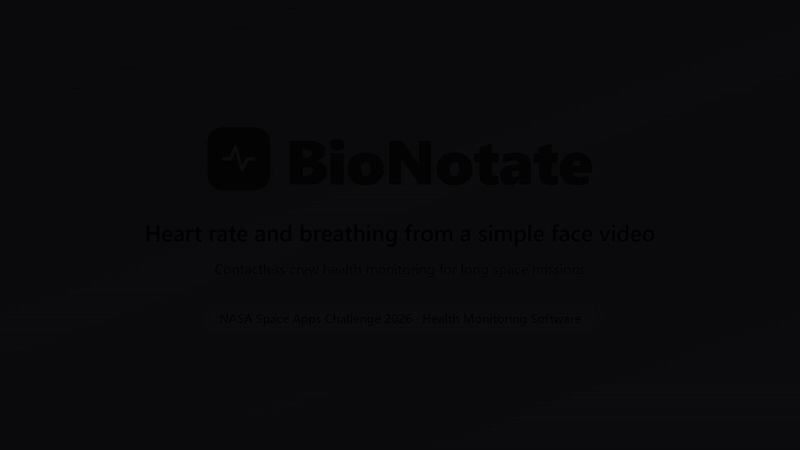

# BioNotate

This solution was developed as part of NASA Space Apps Tel Aviv 2026. The event was led by the Space Engineering Center (SEC) and SpaceTAU at Tel Aviv University, in partnership with the Rakia Mission and Space Campus IL.


**Live site: https://bionotate.web.app** (public, no sign-in)



Full-quality video: [BioNotate_demo.mp4](docs/BioNotate_demo.mp4) (56 s, no sound).

Crew health monitoring and early risk detection for the NASA Space Apps Challenge 2026,
[Health Monitoring Software](https://www.spaceappschallenge.org/2026/challenges/health-monitoring-software/)
challenge, by team BioNotate. A crew member records a short face video or a few voice
clips; the app turns them into vital signs and biomarkers, stores every reading, and
flags anyone who needs a check.

> Demo only. The readings and alerts are illustrative and not a medical assessment.

## What it does

| Page | What it does |
| --- | --- |
| `/` Crew dashboard | The four Artemis II astronauts as demo crew: status per member, latest vitals, trend graphs, and a Status Report of open issues. Refreshes every 15 s. |
| `/upload` Video analysis | Estimates heart rate, respiratory rate and PRQ from a face video (vendored `cardioresp` model, about one reading every 2 s). |
| `/audio` Voice recording | Five short clips (counting normal and fast, vowels a/e/o) go through the vendored `voicebiomarker` model and give a vocal biomarker z-score (research only). |
| `/measurements` Manual entry | Save one blood pressure, glucose or temperature reading at a time. |
| `/mada` Emergency support | Emergency-assessment assistant (see below). Shows "Assistant offline" when no model server is configured, which is the case on the live site. |
| `/docs` | Interactive API documentation. |

**Status colours** (rules in `data/rules.json`):

- **Green:** within range.
- **Yellow, "Check required":** a vital sign is out of range (heart rate 50-100 bpm, respiratory rate 12-20 br/min), or readings are missing.
- **Red, "Needs attention":** any other alert, such as a model score over its threshold or the vocal biomarker rising four checks in a row.

**Long videos.** Videos up to 500 MB are uploaded in 8 MB pieces and analysed in the
background; the page waits for the result in short requests. This keeps every request
under Cloud Run's 32 MB body limit and Firebase Hosting's 60 s timeout. On the live site
the video is deleted after analysis.

### Emergency assistant (MADA)

`/mada` links an emergency report (text, image or audio) to a crew member, asks
follow-up checks, and returns protocol steps alongside the member's history and trends.
The model runs as a separate GPU service (`services/mada/`) and is off by default. Turn it
on with two backend environment variables:

- `MADA_SERVICE_URL`: address of the MADA model server, e.g. `http://127.0.0.1:8010`
- `MADA_DEMO_ENABLED=1`

Do not enable it on the public deployment: the app has no user sign-in yet. Setup and
limitations are in [`docs/MADA_INTEGRATION.md`](docs/MADA_INTEGRATION.md).

## Run locally (Windows)

Needs Python 3.11 or newer (we use 3.12). Run from `backend\`, because
`requirements.txt` installs the model wheels from `backend\vendor\` by relative path.

```powershell
cd backend
py -3.12 -m venv .venv
.\.venv\Scripts\python.exe -m pip install -r requirements.txt
.\.venv\Scripts\python.exe -m uvicorn app.main:app --reload
```

Open http://127.0.0.1:8000/. The same server serves the API and the pages; there is no
separate frontend build. On macOS/Linux use `python3 -m venv .venv` and `.venv/bin/python`.

Tests, from `backend\`:

```powershell
.\.venv\Scripts\python.exe -m pip install pytest
.\.venv\Scripts\python.exe -m pytest -q
```

### With Docker

```bash
docker compose -f compose.yaml -f compose.dev.yaml up --build   # development, auto-reload
docker compose up --build -d                                    # production image
```

Open http://localhost:8000/. Set `APP_PORT=8001` if port 8000 is taken. Uploads and the
working database persist in named volumes (`docker compose down -v` deletes them).

## Data

Everything is stored in one SQLite file, `backend/astrohealth.db` (git-ignored; set
`ASTROHEALTH_DB` for another path). Schema: `data/schema/production.sql`.

- **astronauts:** crew IDs, names and roles.
- **predictions:** one row per model run (video, voice clips), with the full model output and whether it is an alert.
- **measurements:** every numeric reading (model output, manual entries, imported biology values), used for graphs and trends.

**Demo data.** On startup the app merges the reviewed snapshot `data/seed/shared_demo.db`
into the working database. Repeat merges add no duplicates and never overwrite local
records. A database with no data at all is also loaded from `data/seed/astrohealth_seed.json`.

**Sharing your data with the team.** Export your local database to the JSON seed, then
commit the file:

```powershell
cd backend
.\.venv\Scripts\python.exe -m app.seed export
```

Each row is one line, so new rows show up clearly in `git diff`.

## Deploy

Every push to `main` deploys automatically: GitHub Actions
(`.github/workflows/deploy.yml`) builds the `Dockerfile` on Google Cloud Run (project
`bionotate`, `us-central1`), and Firebase Hosting serves it at https://bionotate.web.app.
GitHub signs in to Google with Workload Identity Federation, so no keys are stored in the
repo. Cloud Run keeps the database in `/tmp`, so data added on the live site resets when
the instance restarts; the demo snapshot is reloaded on each start.

## Repository layout

```text
backend/app/        FastAPI app: main.py (pages), routers/ (API), models/ (video and voice adapters),
                    db.py (SQLite), extractors.py (model output -> measurements), seed.py
backend/vendor/     cardioresp and voicebiomarker wheels
backend/tests/      unit and end-to-end tests
frontend/           HTML/CSS/JS for every page
data/               rules.json (alert ranges), biomarkers.json, seed/, schema/, ui/ (crew photos, icons)
services/mada/      MADA emergency model service (GPU, run separately)
docs/               demo video, MADA integration notes and diagrams
```

## Credits

The demo crew are the Artemis II astronauts Reid Wiseman, Victor Glover, Christina Koch
and Jeremy Hansen. Their photos are NASA photographs, in the public domain in the United
States, taken from Wikimedia Commons (sources in
[`data/ui/crew/CREDITS.md`](data/ui/crew/CREDITS.md)). Their health readings are demo
data, and NASA does not endorse this project.
