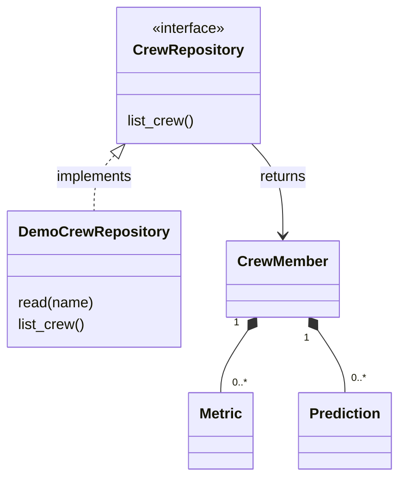
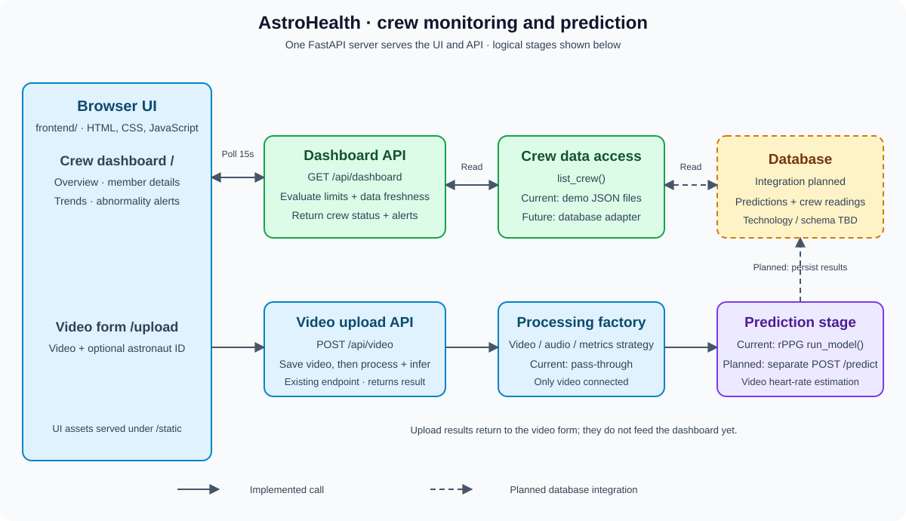

# Crew dashboard

Start the app using the [root instructions](../README.md). FastAPI serves both UI and API; there is no frontend build.

## Screen and interactions

- **Overview:** counts for total crew, healthy, needs attention, and unknown/stale readings.
- **Crew cards:** name, role, astronaut ID, latest metrics, observation time, status, and a details button. Filter by status.
- **Member details:** recent metric trends, configured ranges, latest model prediction scores, and member-specific alerts. Charts show reading sequence, not elapsed time.
- **Alerts:** rule explanations with a direct link to the affected member. These are current snapshot exceptions; acknowledgement, saved alert history, and external notifications are not implemented.
- **Navigation:** the header on both pages links to **Dashboard** and **Upload video**, highlighting the current page.
- **Video upload:** `/upload` sends a video and optional manually entered astronaut ID to the rPPG heart-rate estimator. Results do not feed the dashboard yet.

The browser polls `/api/dashboard` every 15 seconds. **Refresh data** fetches immediately. Failures preserve the last snapshot with a warning.

## Demo data and rules

The backend reloads these files on each request; records join by astronaut ID:

| File | Contents |
| --- | --- |
| `data/astronauts.json` | IDs, names, roles; future `users` table |
| `data/metrics.json` | Timestamped readings; latest values and recent history |
| `data/predictions.json` | Timestamped synthetic model scores; latest per target |
| `data/rules.json` | Metric ranges, prediction thresholds, freshness duration |

Status is calculated by the backend, never stored on a user:

- **Needs attention:** a latest metric is outside its inclusive range or a prediction meets/exceeds its threshold.
- **Unknown:** no alert, but required metrics are missing or observations are stale.
- **Healthy:** required metrics are present/fresh and no rule triggers. This is an illustrative demo label, not a clinical assessment.

The demo clock is the latest timestamp in the fixtures. Stale abnormal readings retain alerts; missing predictions alone do not make status unknown. All readings, scores, and limits are synthetic.

## Class interactions

Request flow: `dashboard.js` → `GET /api/dashboard` → `build_snapshot()` → `CrewRepository.list_crew()` → `evaluate_member()`. Member evaluation calls separate metric, prediction, freshness, and status functions. The diagram shows the actual repository and data-model classes. `get_repository()` supplies the implementation; Itamar's database adapter will implement the same repository interface.

## Files and integration

`index.html` defines the layout; `dashboard.css` handles styling and responsive behavior; `dashboard.js` fetches data, renders cards, filters, and opens details; `upload.html` preserves the upload form.

Backend: [`repository.py`](../backend/app/dashboard/repository.py) joins demo records; [`routers/dashboard.py`](../backend/app/routers/dashboard.py) evaluates status and alerts; [`main.py`](../backend/app/main.py) serves the UI/API. Tests live in [`test_dashboard.py`](../backend/tests/test_dashboard.py).

Itamar can replace `get_repository()` with an adapter implementing `CrewRepository.list_crew()` for the planned users/metrics/predictions tables. Keep stable astronaut IDs, timezone-aware observation timestamps, metrics with ranges/history, and prediction scores/thresholds. The API currently marks its response as `demo`; update that and demo UI copy when integrating live data. The UI does not recognize people automatically: selecting a registered astronaut before upload is a possible next step; automatic identity recognition is separate work.

